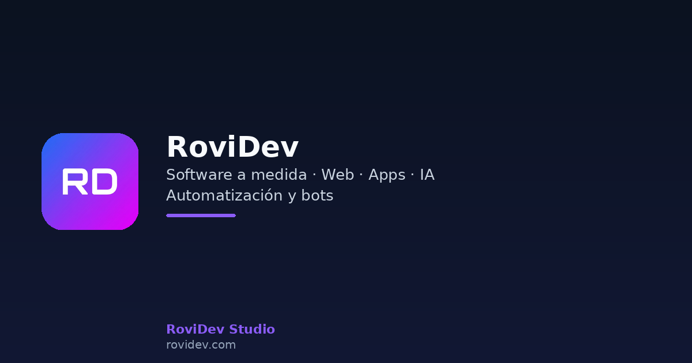

# Francisco Peris · RoviDev

**Freelance software developer.** I build and maintain backends, SaaS products and
integrations — APIs, payments, real-time systems and AI features.

---

### Stack

### What I work on

- Payment & webhook integrations (Stripe) with idempotency and retries
- Multi-tenant SaaS: auth, RBAC, billing and plan limits
- Retrieval-augmented generation (RAG) and LLM features on your own data
- Real-time systems: WebSockets, monitoring and alerting
- Web scraping & data pipelines: price/availability monitoring, exports to Sheets/API

### Selected projects

| Project | What it is | Stack | Links |
| --- | --- | --- | --- |
| [webhooks-engine](https://github.com/rovidev95/rovidev-webhooks-engine) | Idempotent webhook processing with retries and dead-letter queue | TypeScript · Node · Redis | [npm](https://www.npmjs.com/package/@rovidev/webhooks-engine) |
| [saas-starter](https://github.com/rovidev95/rovidev-saas-starter) | Multi-tenant SaaS starter with RBAC and Stripe billing | Next.js · Prisma · Stripe | [Live demo](https://rovidev-saas-starter.onrender.com) |
| [rag-agent](https://github.com/rovidev95/rovidev-rag-agent) | RAG service with grounded answers and source citations | Python · FastAPI · OpenAI | — |
| [membership-bot](https://github.com/rovidev95/rovidev-membership-bot) | Paid community access driven by Stripe subscriptions | Python · FastAPI · Stripe | — |
| [realtime-monitor](https://github.com/rovidev95/rovidev-realtime-monitor) | Live service monitoring with a WebSocket dashboard | TypeScript · Node · WS | [Live demo](https://rovidev-realtime-monitor.onrender.com) |
| [business-scraper](https://github.com/rovidev95/rovidev-business-scraper) | Polite price/availability monitor with change detection | Python · FastAPI | — |

### Languages

---

Looking for a developer for a specific project? → **[rovidev.com](https://rovidev.com)**

